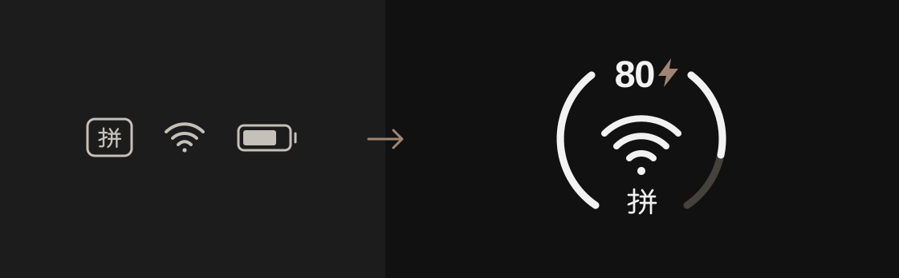

# Xing.Zhu

我做一些自己每天会用到的 macOS 小工具。  
I build small macOS tools for everyday use.

## DuoStatus

把电量、Wi-Fi 和输入法合到一个菜单栏图标里，仍可点开 macOS 原生 Wi-Fi 面板。  
Battery, Wi-Fi, and input source in one menu bar item, with the native Wi-Fi panel one click away.

**[下载 Download](https://github.com/zhuxc1221/DuoStatus/releases/latest)** · [源码 Code](https://github.com/zhuxc1221/DuoStatus) · [反馈 Issues](https://github.com/zhuxc1221/DuoStatus/issues)

*Hey, who is JSON?*
